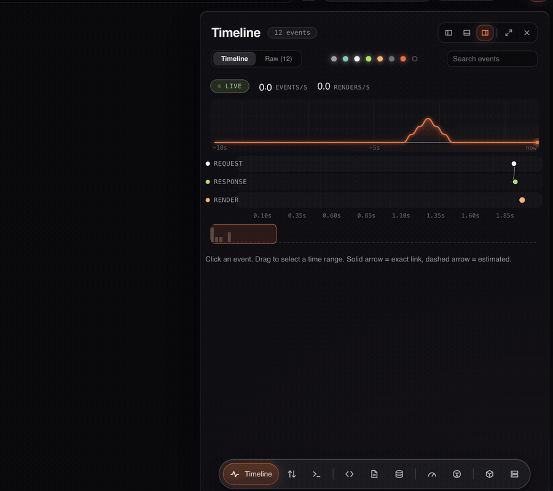
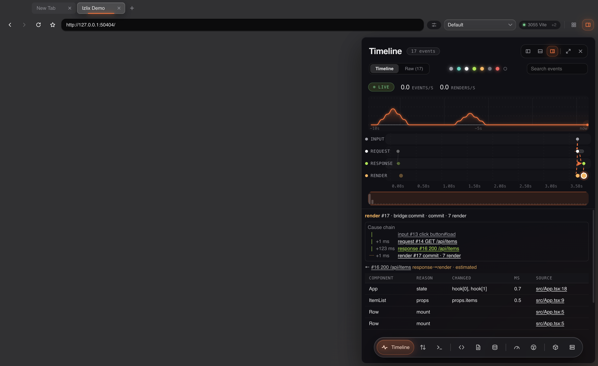
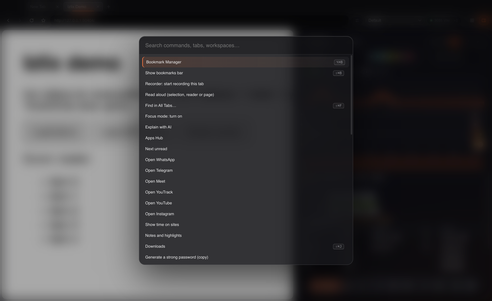
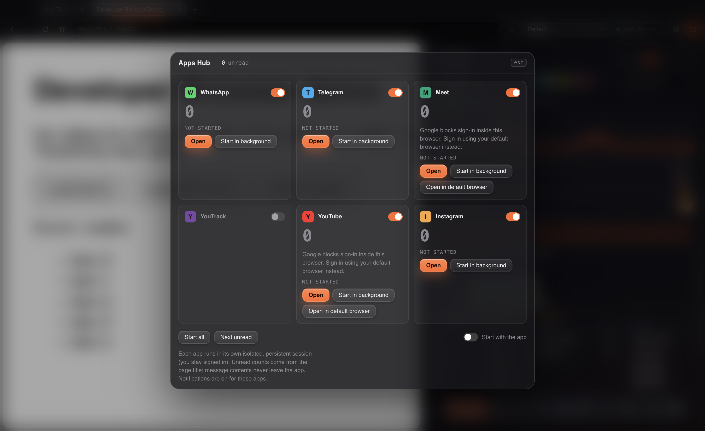
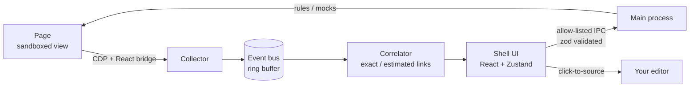

<p align="center">
  
</p>

<p align="center">
  <a href="https://github.com/thEmircn/izlix/actions/workflows/ci.yml"></a>
  
  
  
  
  
</p>

**Izlix** (from the old Turkic *iz*, "trace") is a **React-aware development browser** for macOS. When something breaks, you see *why*: the click, the request it fired, the response, the state change and the render that followed are drawn on **one timeline with cause arrows**. Click any component, render, error or request and the source file opens at the exact line in your editor.

<p align="center">
  
</p>

> **Status: alpha.** macOS only, not signed, no auto-update. Please read [Limitations](#limitations) before using it as your main browser.

---

## See · Find · Change

<table>
<tr>
<td width="33%" valign="top">

### See
- **Unified timeline**: input → request → response → render → error on one axis. Every link is marked *exact* or *estimated*.
- **React Inspector** and render tracker: props, state, hooks, render count, time and reason (React 18 and 19).
- Own **Network, Console, Elements, Sources** (breakpoints, source maps), **Storage, Performance, Coverage, Accessibility, SEO** panels.
- **State panel** for Zustand and Redux.

</td>
<td width="33%" valign="top">

### Find
- **Click-to-source**: component, render, error or request → `file:line` in VS Code, Cursor or WebStorm.
- **Workspaces** with isolated cookies and storage; running dev servers are detected in seconds.
- **Command palette** (⌘K), search across all tabs, session recorder with Playwright export and replay.

</td>
<td width="33%" valign="top">

### Change
- **Request rules** per workspace: redirect, headers, JSON mock, latency, status code. Changed requests are badged on the timeline.
- **Responsive Lab**: up to 4 synchronized viewports, device, network, CPU, geolocation and media emulation.
- **Bug report** zip: timeline, HAR, screenshot, console, environment and a Markdown summary, with tokens and cookies masked.

</td>
</tr>
</table>

<p align="center">
  
  
</p>

## It is also a real browser

Tabs and groups · vertical tabs · bookmarks and history · download manager · built-in password manager (macOS Keychain) · private and Tor tabs · ad and tracker blocker · HTTPS-only · malware and look-alike site warning · translate · reader mode with read-aloud · page notes and highlights · picture-in-picture · multi-window with shared tabs · optional end-to-end encrypted iCloud Drive sync · and an **Apps Hub** for WhatsApp, Telegram, Meet, YouTrack, YouTube and Instagram with unread counts.

<p align="center">
  
</p>

## Run it

```bash
npm install
npm run dev          # development (electron-vite)
npm test             # unit tests (vitest)
npm run typecheck
npm run pack         # unsigned .app in dist/
python3 tests/e2e/suite.py [name ...]   # end-to-end suite on a real Electron (quiet mode)
```

`ELECTRON_RUN_AS_NODE` must not be set (the scripts clear it). Some end-to-end scripts expect a Vite + React 19 test app: point `DB_TESTAPP` to its folder and serve it on `localhost:5173`.

Open a project from the terminal with `izlix open .` (see `bin/izlix.js`). An optional Chrome helper extension in `extension/` opens the current page in Izlix.

## Izlix for Chrome (alpha)

The same core also runs as a **Chrome extension**: the timeline with cause arrows, request rules and click-to-source in a side panel, inside the browser you already use (and where Google sign-in works).

```bash
npm install
npm run build:ext
# chrome://extensions -> turn on Developer mode -> Load unpacked -> packages/extension/dist
```

Open your React app on `localhost`, click the Izlix toolbar button; the page reloads with tracing on. Chrome shows its standard "started debugging this browser" bar while the extension is attached. Early alpha: the timeline, network, console, render tracker, request rules (mock, delay, redirect, status, headers) and click-to-source are available; the other panels of the desktop app are not ported yet.

## How it works



- `src/main`: windows and tabs, CDP collector, React bridge, event bus, correlator, source resolver, request interceptor, lab.
- `src/renderer`: the shell UI. It never talks to pages directly; everything goes through allow-listed, zod-validated IPC.
- `src/shared`: pure logic (rules engine, layout, search, masking, correlation), unit tested.

## Limitations

- **No Google sign-in.** Google refuses sign-in inside embedded Chromium browsers. Use another browser for Google accounts. The hub offers "open in default browser".
- **Unsigned, no auto-update.** Chromium security fixes arrive only when you update Electron (`npm run update-electron`). The app checks and tells you.
- No extension store, passkeys or Widevine DRM (Netflix, Spotify web) with stock Electron.
- The malware and look-alike warning is **not** Google Safe Browsing; its coverage is narrower.
- macOS only.

## Security

Pages run in sandboxed views with no preload and cannot reach IPC. Camera, microphone, location and notifications are denied by default. Telemetry is off unless you opt in. Sign-in requests are never recorded on the timeline, and exports mask tokens and cookies. To report a vulnerability, please open a private security advisory on GitHub.

## Türkçe özet

**Izlix**, React geliştiricisi için macOS'ta çalışan bir geliştirici tarayıcısıdır. Adı Eski Türkçe *iz* kelimesinden gelir. Bir hatanın sebebini tıklamadan render'a kadar **tek zaman çizelgesinde** görürsünüz, kaynağını tek tıkla editörünüzde açarsınız, backend'e dokunmadan istekleri değiştirirsiniz. Alfa sürümdür; Google hesabı girişi, imzalı sürüm ve otomatik güncelleme henüz yok.

## License

[Apache-2.0](LICENSE)
